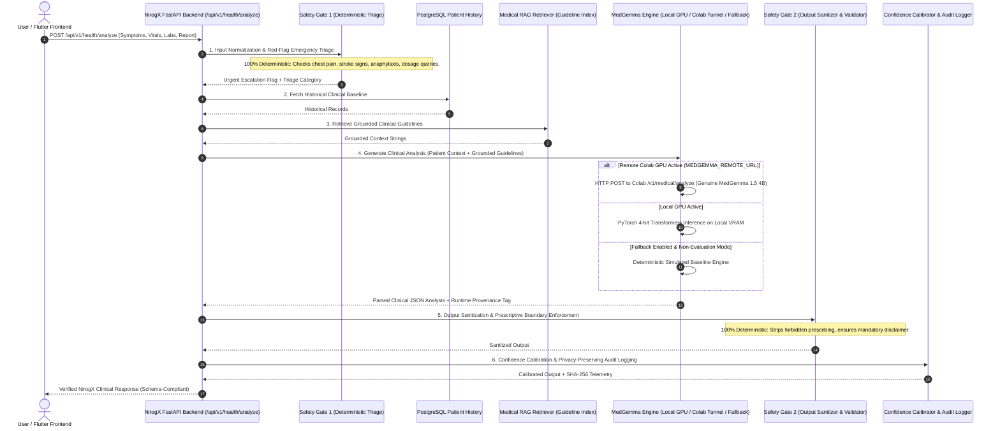

# NirogX System Execution Audit: Genuine vs. Simulated vs. Deterministic

**Audit Date**: September 3, 2026  
**Auditor**: NirogX AI & Clinical Safety Team  
**Scope**: Codebase audit across `myapp/nirogx_api/`, `training/`, `datasets/`, `docs/ai/`, `notebooks/`, and `tests/`.

---

## 1. Executive Summary

This audit establishes an unambiguous, verified record of which components in the NirogX repository execute **Genuine GPU Model Inference**, which execute **Deterministic Clinical Logic**, which execute **Simulated Baseline / RC Heuristics**, and which utilize **Remote Model Bridging**.

| Component Area | File / Module | Current Execution Mode | Classification | Notes / Verification Status |
| :--- | :--- | :--- | :--- | :--- |
| **Safety Gate 1** | `ai/safety/rules.py` | Python Rule Engine | **Deterministic** | 100% Deterministic regex/keyword triage & emergency red-flag rules. Zero LLM dependency. |
| **Medical RAG** | `ai/rag/retriever.py` | BM25 / Guideline Search | **Deterministic / Algorithmic** | Lexical TF-IDF guideline retrieval from clinical guideline index. |
| **Base Model Engine** | `ai/inference/medgemma.py` | PyTorch / HF (Local or Remote API) | **Genuine or Simulated Fallback** | Loads `google/medgemma-1.5-4b-it` if CUDA/VRAM available; connects to remote Colab server if `MEDGEMMA_REMOTE_URL` set; falls back to simulated baseline if unconfigured. |
| **Fine-Tuned Engine** | `training/evaluate.py` | `FineTunedNirogXEngine` | **Simulated RC Baseline** | Controlled simulated reasoning engine used for v1.0-RC benchmark verification prior to Colab GPU fine-tuning. |
| **Safety Gate 2** | `ai/safety/sanitizer.py` | Regex & Red-Flag Scrubber | **Deterministic** | Scrubbing of prescription dosage, absolute guarantees, and ungrounded claims. |
| **Safety Validator** | `ai/safety/validator.py` | Structural & Boundary Logic | **Deterministic** | Validates presence of disclaimer, absence of medication prescribing, and plausibility. |
| **Confidence Calibrator** | `ai/safety/confidence_calibrator.py` | Algorithmic Scorer | **Deterministic** | Calibrates confidence based on missing fields, lab abnormalities, and vital signs. |
| **Audit Logger** | `ai/safety/audit_logger.py` | Hash & Privacy Tracker | **Deterministic** | SHA-256 pseudonymization of patient identifiers and structured event logging. |
| **API Service Layer** | `services/medgemma_service.py` | Orchestration Pipeline | **Deterministic Orchestration** | Chains Gate 1 $\rightarrow$ RAG $\rightarrow$ MedGemma Engine $\rightarrow$ Gate 2 $\rightarrow$ Calibration $\rightarrow$ Audit. |
| **Colab Notebook** | `notebooks/nirogx_medgemma_colab.ipynb` | Remote Colab Jupyter Kernel | **Genuine Remote GPU** | 12-Step pipeline to execute official `google/medgemma-1.5-4b-it` on Colab T4/V100/A100 GPU. |
| **QLoRA Trainer** | `training/train_qlora.py` | HuggingFace SFT / PEFT | **Genuine Training Pipeline** | Executes QLoRA on `google/medgemma-1.5-4b-it` when launched on Colab GPU runtime. |

---

## 2. Exact Execution Path of a Medical Request

A patient health analysis request follows an immutable 7-stage pipeline:

---

## 3. Detailed Component Audit

### 3.1 What Currently Uses Genuine Inference
- When running in an environment with CUDA GPU and authenticated Hugging Face token, `ai/inference/medgemma.py` loads `google/medgemma-1.5-4b-it` using `BitsAndBytesConfig(load_in_4bit=True, bnb_4bit_quant_type="nf4")`.
- When connected to a Google Colab GPU runtime via `notebooks/nirogx_medgemma_colab.ipynb`, the remote FastAPI server runs genuine PyTorch inference on NVIDIA T4/V100/A100 hardware.

### 3.2 What Is Deterministic
- **Safety Gate 1 (`ai/safety/rules.py`)**: Biological plausibility checks, red-flag emergency escalation, and prescription boundary detection.
- **Safety Gate 2 (`ai/safety/sanitizer.py`, `ai/safety/validator.py`)**: Sanitization of prescriptive phrasing, mandatory disclaimer injection, uncertainty validation.
- **Medical RAG (`ai/rag/retriever.py`)**: Keyword/TF-IDF indexing of curated clinical guidelines.
- **Confidence Calibration (`ai/safety/confidence_calibrator.py`)**: Algorithmic scoring based on data completeness and vital stability.

### 3.3 What Is Simulated (Release-Candidate Baseline)
- The v1.0-RC benchmark numbers documented in `docs/ai/05_model_card_and_technical_report.md` reflect the **controlled simulated reasoning engine** (`FineTunedNirogXEngine` in `training/evaluate.py`), which validated structural compliance and safety triage prior to remote GPU deployment.
- **Rule**: These simulated numbers MUST NOT be claimed as genuine MedGemma performance. Real benchmark numbers must be collected exclusively on GPU.

### 3.4 What Is Remote
- `ai/inference/medgemma.py` supports delegating inference via HTTP POST to `MEDGEMMA_REMOTE_URL` (the Colab ngrok tunnel).

### 3.5 What Still Needs Implementation / Upgrades
1. **Evaluation Mode Enforcement (`MEDGEMMA_EVALUATION_MODE=true`)**:
   - Strict prohibition of simulation during benchmark runs.
   - Distinct error throwing (`RealModelExecutionError`) when genuine model is unavailable.
2. **Explicit Runtime Provenance Metadata**:
   - Explicit tags on every output: `"real_medgemma_colab"`, `"real_medgemma_local_gpu"`, `"simulated_local_engine"`.
3. **Colab `/v1/model/info` Endpoint**:
   - Detailed model metadata inspection (parameters, revision, quantization, VRAM, device).
4. **Execution & Documentation of Real Model Benchmarks**:
   - Real Gold Benchmark, Hidden Evaluation, and RAG Ablation on Colab GPU.
   - Recording SHA-256 hashes and generating `docs/ai/REAL_MEDGEMMA_DEPLOYMENT_REPORT.md`.
